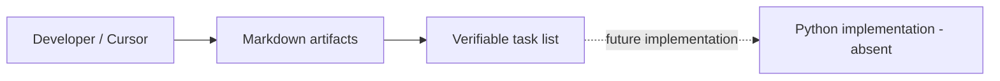

# Architecture (current state)

Last updated: 2026-10-31

## What exists today

This repository contains **planning artifacts and a minimal Python packaging scaffold**.
The `altdown` command, HTTP reader, parser, validator, and fidelity checker **do not exist**.
There is no network path, stateful service, deployed component, or database.

## Current directories

- `docs/adr/`: architectural decisions and templates.
- `docs/features/v0.1-reader-validator/`: proposed first feature work.
- `.cursor/rules/` and `AGENTS.md`: instructions for AI coding tools.
- `src/altdown_tools/`: packaging namespace, with no implementation yet.
- `tests/fixtures/`: synthetic example content (no live external dependency).
- `scripts/`: repository structure check.

## Changes to this file

When an implementation phase adds a module or changes component responsibilities,
update this document in the **same PR** to reflect only the code that is now present.
Describe the current data flow, ports, adapters, and trust boundaries **after** code exists.
Keep proposed architecture and rejected alternatives in the feature plan/ADR, not here.
