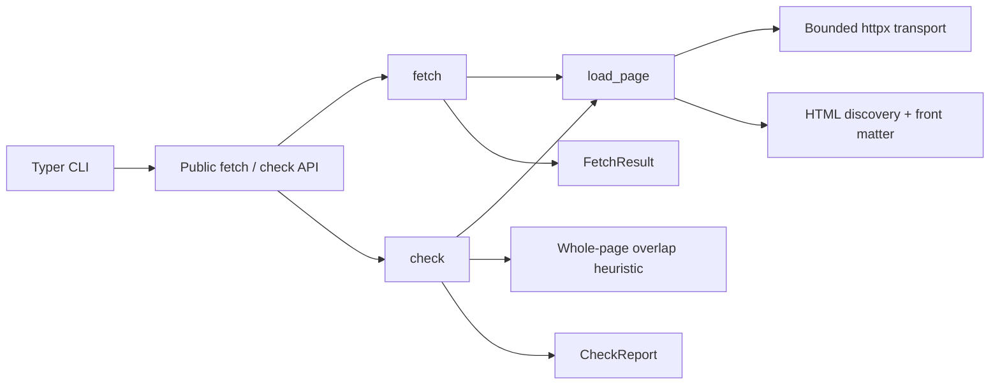

# v0.1 — Reference reader and publisher validator

- Status: **Draft — blocked until ADR Accepted**
- Spec: https://altdown.org/1.0/ (Altdown 1.0 draft; external source of truth)
- ADR: [Separate reader and validator](../../adr/2026-10-31-separate-fetch-and-validation.md)
- Owner: Agent Web Commons
- Target: Python 3.12+, `uv`, `httpx`, `beautifulsoup4`, `typer`, `pytest`, `respx`, `ruff`

## Problem

A publisher can announce an Altdown copy today, but no vendor-neutral reference
library/CLI in this repository demonstrates safe discovery, URL verification, fallback,
or actionable publisher conformance checks. Build the smallest usable consumer and
validator before standardizing or building more.

## Success measures

- `altdown fetch URL` retrieves a copy that meets the ADR fetch rules **or** explicitly
  reports HTML fallback, without guessing Markdown paths. It does not compute fidelity.
- `altdown check URL` gives machine-readable, reproducible diagnostics for publisher
  failures, with spec section pointers and a distinct heuristic fidelity result.
- The same `load_page` core can be called from Python; CLI and API use identical protocol rules.
- v0.1 reads one URL. It does not crawl a site index or run the draft's multi-page spot
  check, and it does not claim full agent conformance.
- Offline fixture-based tests cover every **must** rule in the v0.1 scope and representative
  rejection/fallback cases. No real network needed for CI.

## User stories

1. As an agent developer, I can call `fetch(url)` and see whether Markdown accepted
   under the ADR fetch rules, or unmodified HTML, was returned, so I never confuse the two.
2. As a website publisher, I can run `check(url)` and get precise, actionable failures.
3. As a maintainer, I can run the same checks offline and trust their determinism.

## Proposed component boundaries (not current architecture)

Normative tool policy for the bullets below lives in the
[ADR Decision](../../adr/2026-10-31-separate-fetch-and-validation.md). Implement that
text. This section restates it so phase work has one picture.

### Explicit behavior

- **Shared load:** `fetch` and `check` call `load_page` for HTTP, redirects, robots,
  discovery, and front matter. Validator-only rules run after that load.
- **Fetch:** request the public HTTP(S) URL the user named. Follow at most 5 redirects.
  Compare `canonical` with the final page URL. Return Markdown only when the ADR accept
  list holds, with `format=markdown, source=altdown`. Otherwise return raw HTML with
  `format=html, source=html-fallback` and a reason (exit 0). Timeout, redirect-loop,
  oversize, or URL-policy refusal of that named URL is exit 3.
- **Negotiation:** send `Accept: text/markdown, text/html;q=0.9`. A direct Markdown
  response still requires an HTML fetch that finds the link element. If that check
  fails, return HTML fallback.
- **Translations:** when several Markdown alternates exist, select the `hreflang` that
  equals the page's `html lang`. If none matches, `fetch` returns HTML and `check` errors.
- **Check:** errors are exit 1 and warnings are exit 0, as listed in the ADR. Issue
  codes include `COPY_NOT_OK`, `ROBOTS_DISALLOW`, and `FIDELITY_LOW`. There is no
  separate "unsafe HTML" rule: `script`, `style`, and HTML comments are errors.
- **Fidelity:** `check` only. Whole-page visible text after removing script, style,
  noscript, template, comments, and hidden content. Do not restrict the extractor to
  `main` or `article`. Five-word overlap below 0.90 is `FIDELITY_LOW`. Fewer than five
  normalized words is `indeterminate` and does not fail. Overlap is a heuristic, not
  proof of semantic equivalence, and it does not measure omitted main content.
- **Robots:** apply `robots.txt` to the copy request only. The named page is still
  fetched. `Altdown:` is not permission. Unreachable or missing `robots.txt` allows
  the copy. A disallowed copy is not fetched.
- **Security:** HTTP and HTTPS only. Reject credential-bearing URLs and private,
  loopback, link-local, and reserved targets by default. Budgets: 5 redirects,
  10-second timeout, 1 MiB per body regardless of `Content-Length`, stable User-Agent.
  No cookies, environment proxies, retries, or cache. DNS rebinding is not solved.
  v0.1 is not a hosted fetch service.
- **Signals:** preserve per-copy signals; unspecified stays unspecified. Signals are
  preferences, not authorization, and they do not change fetch permission.
- **API:** `FetchResult` and `CheckReport` typed objects; injectable `httpx.Client`.
  Each check issue has `severity` of `error` or `warning`. CLI emits plain text by
  default and deterministic JSON with `--json`. No network calls during module import.

## In scope

- Importable synchronous Python API plus CLI commands `fetch`, `check`.
- Origin and canonical normalizer per spec/RFC 3986 with redirect-aware comparison.
- One `load_page` path and bounded HTTP retrieval; no path probing.
- Publisher structural validation, heuristic fidelity, tests and diagnostics.
- CI to run pytest + Ruff, packaging smoke test, helpful README.

## Out of scope

- `altdown crawl`, `altdown diff`, JSON Feed index traversal, `robots.txt` index discovery,
  the draft's multi-page spot check, generation of publisher copies, site audits,
  caching/revalidation, persistence, background tasks, browser execution, JavaScript
  rendering, login/cookies/auth, LLM judgments, plugins/MCP, TypeScript SDK, hosted API,
  remote-user URL service.
- Mathematical or adversarial proof of a faithful copy; full CSS cascade/visibility.
- Adding or amending the Altdown specification to make tests pass.

## Phases and review gates

- **0 — Approval and packaging:** human accepts ADR, scaffold and packaging checks.
- **1 — Core parsing and URL rules:** normalization, HTML discovery, front matter,
  shared dataclasses; offline tests.
- **2 — Fetch consumer:** `load_page`, bounded HTTP, robots, fallback, CLI `fetch`
  and JSON output.
- **3 — Publisher check:** structural checks on the same `load_page` result, fidelity
  heuristic, CLI `check` and JSON output.
- **4 — Hardening and release readiness:** adversarial fixtures, docs, integration test,
  CI and architecture update.

Only implement the phase that a human specifically selected. Read
[ACCEPTANCE.md](ACCEPTANCE.md), [TASKS.md](TASKS.md), and [PROMPTS.md](PROMPTS.md)
before writing code.

## Decisions recorded in the ADR

Fetch acceptance, check severities, negotiation, `hreflang` selection, robots, fidelity
extraction, and transport budgets are written in the ADR tool policy. Implement that
text. If a new edge case is still unspecified, add the question here and stop the task.
